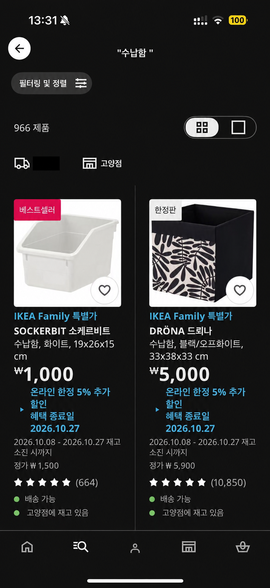
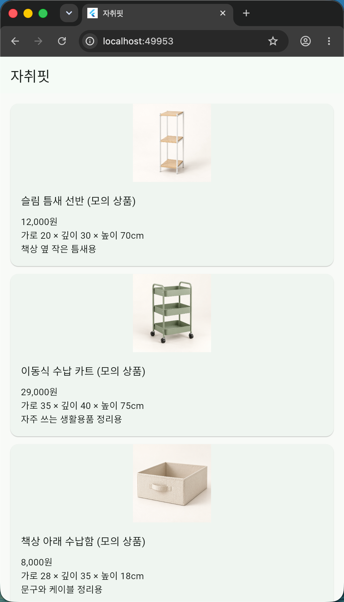
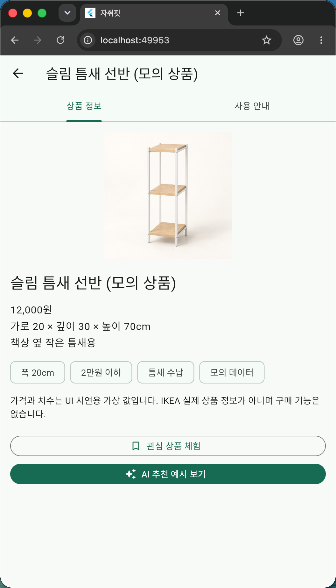
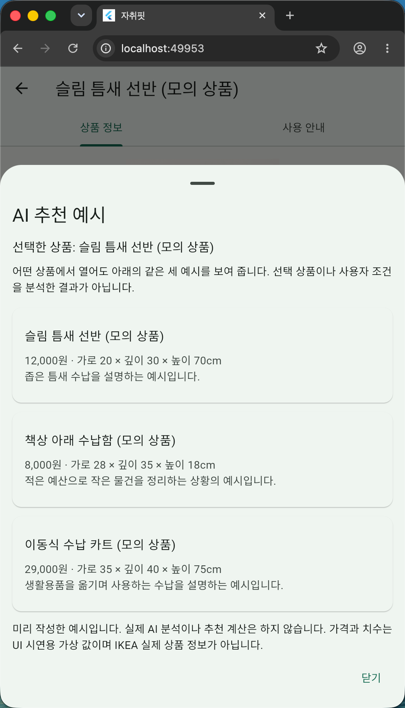
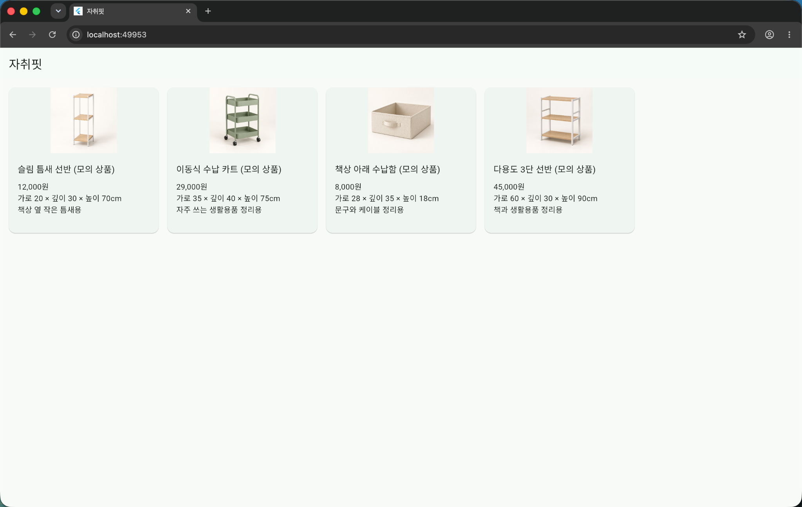
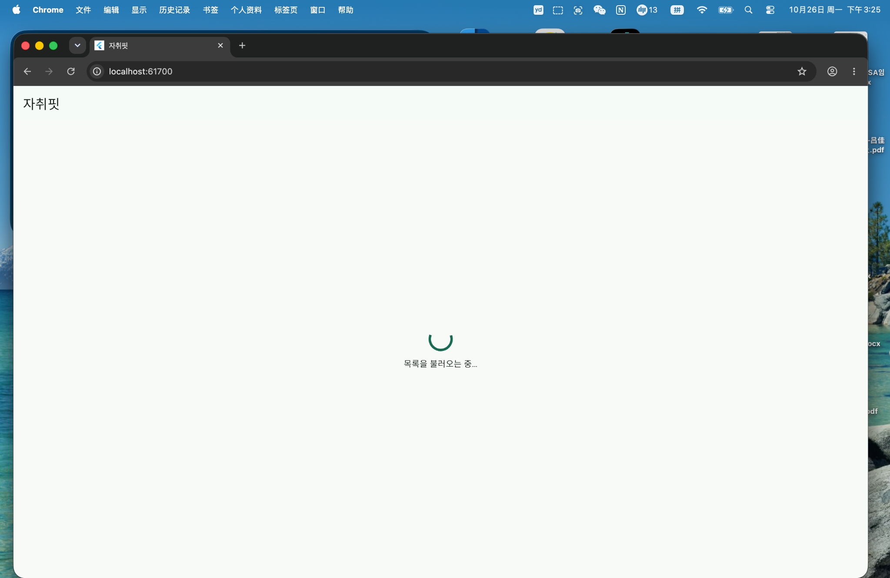
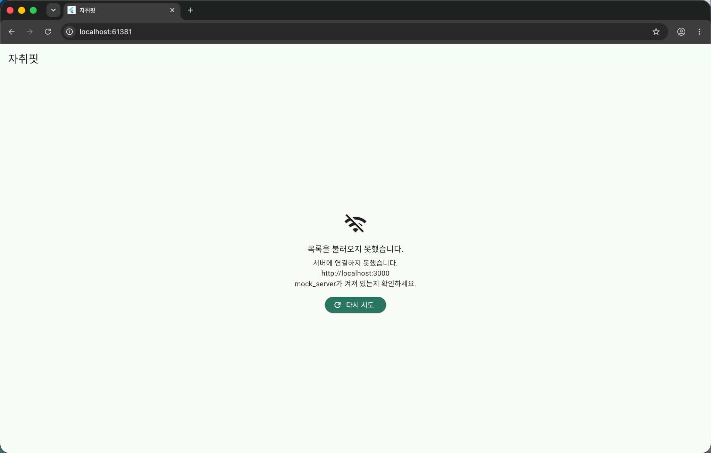
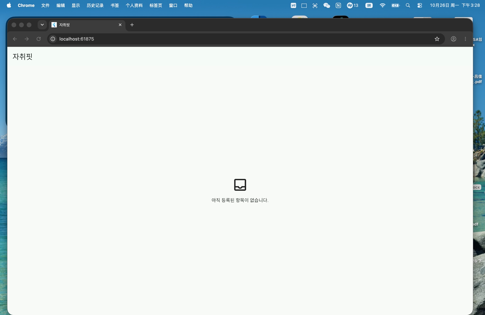
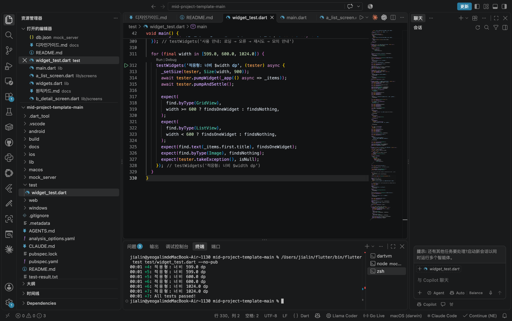
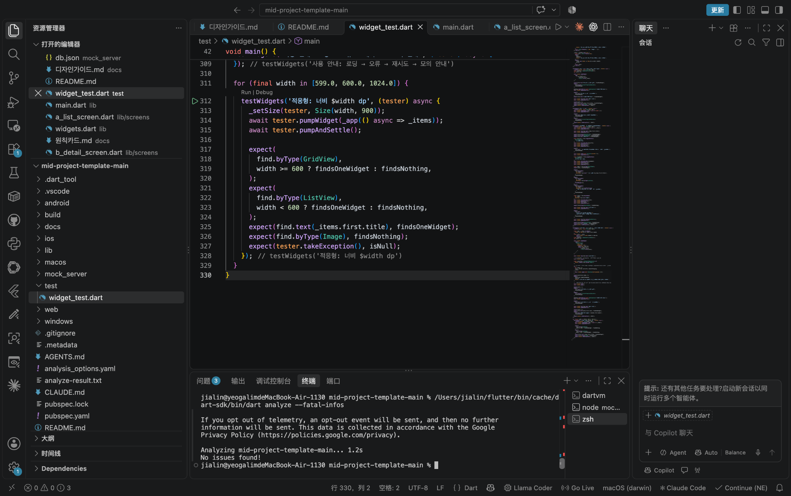

# 자취핏 v2 — GAI3008 중간프로젝트

## 앱 소개

### 앱 이름
자취핏

### 부제
좁은 자취방의 수납용품, 가격과 치수를 한눈에.

### 카테고리
쇼핑 · 라이프스타일

### 대상 사용자 / 사용 상황
- 대상 사용자: 좁은 자취방에서 공간과 예산을 고려해 수납용품을 고르는 대학생.
- 사용 상황: 방을 정리하거나 수납용품을 구매하기 전에 모바일 크기의 화면에서 가격·치수·용도를 살펴보고 상세 안내를 확인한다. 이번 구현은 Chrome에서 시연한다.

### 스크린샷
2026-10-26 캡처한 참고 앱과 자취핏 화면이다. 파일은 `docs/screenshots/`에 저장했으며, 테스트·분석 결과 캡처는 [확인된 상태](#10-확인된-상태)에 별도로 연결했다.

**v1 현행 — 참고 앱 IKEA의 ‘수납함’ 검색 결과**



IKEA 원본 화면에서 가격·치수·필터가 이미 제공됨을 확인했다. 위 이미지는 우편번호를 숨기기 위해 **AI로 개인정보 가림 처리한 참고 이미지**이며, 원본과 픽셀 단위로 동일하지 않다. 원본 캡처는 별도로 보관했다.

**v2 화면 A — 수납용품 목록**



좁은 화면에서 상품명·가격·치수·용도를 같은 순서로 보여 주는 한 열 목록이다.

**v2 화면 B — 수납용품 상세**



첫 번째 선반 상품의 전체 정보와 버튼을 확인할 수 있다. 상품 정보와 사용 안내는 탭으로 구분한다.

**v2 화면 C — 고정 추천 예시**



고정 후보 3개와 추천 이유, 실제 AI 분석이 아니라는 안내, 닫기 버튼을 보여 준다.

**v2 넓은 화면 — 수납용품 격자**



600dp 이상에서 격자로 바뀐 목록과 상품 카드 4개를 보여 준다.

v1은 참고 앱 IKEA를 뜻하며, 자취핏의 이전 출시 버전은 아니다. 리뷰 캡처와 앱 UI 캡처를 구분하고, 공개할 캡처에서는 계정 정보와 리뷰 작성자 이름·프로필 사진을 가린다.

### 설명
1. 자취핏은 수납용품의 가격·가로·깊이·높이·용도를 같은 순서로 보여 주는 Flutter UI 프로토타입이다. 목록에서 상품을 선택하고 상세의 상품 정보와 사용 안내를 확인한다.
2. IKEA 리뷰에서 나타난 탐색의 불편과 구체적인 분류의 장점을 참고했다. 자취핏은 공간과 예산을 살펴볼 때 필요한 정보를 먼저 읽을 수 있도록 구성했다.
3. 좁은 화면에서는 목록, 넓은 화면에서는 격자를 제공한다. 조회 오류에는 다시 시도 버튼을, 안내가 없는 상품에는 빈 상태를 보여 주어 다음 행동을 알 수 있게 한다.

상품 4개와 사용 안내는 모의 데이터이며, 상품 이미지는 AI로 생성한 가상 이미지다. 실제 IKEA 상품을 판매하거나 연결하지 않는다. ‘AI 추천 예시’는 어떤 상품에서 열어도 같은 세 결과를 보여 주며, 실제 AI 분석·개인화·추천 계산은 하지 않는다.

### 새로운 기능
IKEA 리뷰를 참고한 v2 설계이며, 아래 항목은 IKEA에 없는 기능이라는 주장이 아니라 자취핏에 적용한 개선 방향이다. IKEA에도 가격·치수·필터가 있으며, 자취핏은 수납용품의 비교 정보를 같은 순서로 제시하는 데 초점을 맞췄다.

| P번호 | 바뀐 것 (화면 · 요소 번호) | 근거 (리뷰 · 원칙) |
|---|---|---|
| P02 · P08 | A-2 목록에서 가격·치수·용도를 같은 순서로 표시 | R01의 조건 탐색 불편과 R02의 구체적 분류에 대한 긍정 평가를 참고해 비교 정보를 드러냄 |
| P06 | B-4 조건 태그와 C-3 추천 이유를 화면에 표시 | R02를 참고해 기억에 의존하지 않고 조건과 이유를 읽도록 구성. 태그는 필터가 아닌 표시용 |
| P09 | A-5·B-7에 조회 오류 안내와 다시 시도 제공 | R04의 불명확한 결과 안내 경험에서 얻은 시사점을 조회 복구에 적용 |

원칙별 적용 범위와 시연 근거는 `docs/원칙카드.md`, `docs/디자인가이드.md`에 정리한다.

### 평가 및 리뷰
아래는 **참고 앱 IKEA**의 정보다. 자취핏의 별점이나 사용자 평가가 아니다.

| 항목 | 내용 |
|---|---|
| 현행 별점 | ★ 4.8 — Google Play IKEA, 2026-10-25 수집 캡처 기준 |
| 리뷰 수 | 화면 표시 25.5만개 — 반올림된 표시값 |
| 대표 리뷰 | “제품도 많고, 원하는 제품 구매하기도 편하고..” — R02 · ★5 · 2022-10-25, 작성자 익명 처리 |
| 출처 | [Google Play IKEA 한국어 페이지](https://play.google.com/store/apps/details?id=com.ingka.ikea.app&hl=ko) · 수집일 2026-10-25 |

리뷰 R01–R04의 날짜·별점·해석은 `docs/리뷰분석.md`를 따른다. 서로 다른 시기의 개인 경험을 참고한 것으로, 현재 IKEA의 결함이나 자취생 전체의 요구를 검증한 결과는 아니다.

---

## 작성자 · 제출 정보

| 칸 | 내용 |
|---|---|
| 현행 앱 | [IKEA](https://play.google.com/store/apps/details?id=com.ingka.ikea.app&hl=ko) — 리뷰 및 UI 참고 대상 |
| v2 한 문장 | 자취방 수납용품의 가격·치수·용도를 같은 순서로 살펴보는 UI |
| 작성자 | L.J.L. · 1인 1팀 |
| 데모 | [전체 데모 60초](docs/영상/demo.mp4) · [오류·복구 클립 10초](docs/영상/p09.mp4) |
| AI 사용 | 규칙 `AGENTS.md` · 기록 `docs/prompt-log.md` · 셀프 논증 `docs/셀프논증.md` |
| GitHub 제출 | [공개 저장소](https://github.com/jialin0717/jachwifit-midterm) · 새 clone에서 주요 화면·테스트·오류 복구 확인 · LMS 제출 완료 여부는 미확인 |

이 저장소는 **중간프로젝트용 UI 구현**이다. JSON GET 조회와 화면 전환은 동작하지만 로그인·결제·영구 저장은 구현하지 않는다. 관심 상품 체험 버튼은 저장하지 않는다는 SnackBar만 표시한다. 검색·필터·공간 검증도 구현하지 않는다.

## 0. 프로젝트 준비

저장소 루트는 `pubspec.yaml`이 있는 폴더다. 로컬 폴더명은 달라도 되며, Flutter 도구의 경로 문제를 줄이기 위해 영문 경로를 권장한다. 아래 실행 명령은 저장소 루트에서 시작한다.

- Flutter SDK와 Chrome, Node.js 18 이상 및 npm을 준비한다.
- 템플릿의 Dart SDK 요구사항은 `^3.10`이며, 실제 설치 버전은 `flutter --version`으로 확인한다.
- Dart 패키지 이름은 `pubspec.yaml` 기준을 유지한다. 화면에 보이는 앱 이름과 패키지 이름은 다르다.
- `node_modules/`나 개인 SDK 폴더를 저장소에 올리지 않는다.

## 1. 실행 방법 — 터미널 2개

### 터미널 1 — 목업 서버

```bash
cd mock_server
npm install
npm start
```

새로 clone한 환경에서는 먼저 `npm install`을 실행한다. 현재 사용하는 json-server 버전은 **0.17.4**이며, 시작 스크립트는 다음과 같다.

```text
json-server --watch db.json --port 3000 --host 0.0.0.0
```

이 터미널을 켜 둔 채 두 번째 터미널에서 앱을 실행한다. 브라우저에서 다음 주소를 열어 서버를 확인할 수 있다.

- `http://localhost:3000/items` — 상품 4개
- `http://localhost:3000/notes?itemId=1` — 상품 1의 모의 사용 안내
- `http://localhost:3000/images/slim-shelf.png` — 상품 이미지

이미지 파일 4장은 `mock_server/public/images/`에 있어야 한다. 서버 실행 중 `public/images/` 폴더를 처음 추가했다면, 터미널 1에서 `Ctrl+C`로 종료한 뒤 `npm start`로 재시작한다.

### 터미널 2 — Flutter 앱

저장소 루트에서 실행한다.

```bash
flutter pub get
flutter run -d chrome
```

`flutter` 명령을 찾지 못하면 설치한 Flutter SDK의 `bin/flutter` 실행 파일 경로를 확인한다. 해당 절대 경로로 `pub get`과 `run -d chrome`을 실행할 수 있다. 다른 사람의 설치 경로를 그대로 복사하지 않는다.

Flutter 웹 포트는 실행할 때 달라질 수 있으므로 터미널에 표시된 주소를 따른다. 목업 서버 포트는 **3000**이다.

### 실행 환경과 이미지 주소

이번 확인 범위는 **로컬 Chrome**이다. `db.json`의 이미지 주소가 `http://localhost:3000/images/...`로 고정되어 있다.

Android 에뮬레이터에서 API 주소를 `10.0.2.2`로 바꾸더라도 이미지 주소까지 자동으로 바뀌지는 않는다. 실기기·다른 컴퓨터·배포 환경에서 실행하려면 API 주소와 이미지 주소를 함께 조정하고 별도로 확인해야 한다.

### 오류와 재시도 시연

1. 앱과 서버를 실행해 목록을 확인한다.
2. 터미널 1에서 `Ctrl+C`로 서버를 종료한 뒤 앱을 새로고침해 조회 오류를 확인한다.
3. 터미널 1에서 `npm start`로 서버를 다시 켠다.
4. 앱에서 **다시 시도**를 눌러 목록이 복구되는지 확인한다.

촬영한 `p09.mov`에는 오류 화면, 서버 재시작, 다시 시도, 목록 복구가 담겨 있다. 서버를 종료하는 동작 자체는 영상에 나오지 않는다.

### 상태 화면 확인용 옵션

공개 저장소의 `lib/api.dart`에서 `String.fromEnvironment('DEMO_STATE')`와 상태별 분기를 확인했다. `loading` 또는 `slow`는 조회 전에 3초를 기다린 뒤 실제 GET을 진행하므로 로딩 화면이 계속 유지되는 옵션이 아니다. `error`는 예외를 발생시키고, `empty`는 빈 목록을 반환한다. 실행 중인 Flutter 앱을 종료한 뒤 필요한 명령 하나를 실행한다.

```bash
flutter run -d chrome --dart-define=DEMO_STATE=loading
flutter run -d chrome --dart-define=DEMO_STATE=error
flutter run -d chrome --dart-define=DEMO_STATE=empty
```

2026-10-26에 `loading` 옵션의 로딩 화면과 `empty` 옵션의 빈 목록 화면을 캡처로 확인했다. 로딩은 3초 지연 뒤 실제 GET을 진행하며, 빈 목록은 옵션으로 강제한 결과이지 실제 상품 데이터를 삭제한 결과가 아니다. 오류 화면은 별도 clone에서 실제 서버 연결 실패로 확인했다.

| 상태 | 확인 화면 |
|---|---|
| 로딩 |  |
| 오류 |  |
| 빈 목록 |  |

## 2. 구조

주요 코드와 제출 자료의 경로는 다음과 같다. 앱 UI 스크린샷 5개, 상태 화면 3개, 테스트·분석 결과 캡처 2개를 합쳐 이미지 10개를 연결했다. 기획·설계·AI 사용·자가평가 문서 9개가 공개 저장소에 있으며, 자가평가는 확인한 근거와 점수를 작성해 반영했다. 발표자료와 발표 원고는 저장소와 별도 파일로 준비했다.

### 문서 바로가기

| 문서 | 내용 |
|---|---|
| [사업 요약](docs/사업요약.md) | 대상 사용자와 서비스 방향 |
| [저니](docs/저니.md) | 사용자 여정 |
| [원인 분석](docs/원인분석.md) | 피쉬본 및 5 Why |
| [디자인 가이드](docs/디자인가이드.md) | 화면 요소와 설계 근거 |
| [리뷰 분석](docs/리뷰분석.md) | 참고 앱 리뷰와 해석 |
| [원칙 카드](docs/원칙카드.md) | P01–P10 적용과 시연 근거 |
| [prompt-log](docs/prompt-log.md) | AI 사용 기록 |
| [셀프 논증](docs/셀프논증.md) | 기획과 구현의 차이 및 근거 |
| [자가평가](docs/자가평가.md) | 근거별 자가평가 작성 완료 · 발표 제외 79/85 · 발표 평가는 수행 후 기록 |

```text
저장소 루트/
├── README.md
├── AGENTS.md
├── pubspec.yaml
├── lib/
│   ├── main.dart
│   ├── api.dart                  # 상품·사용 안내 GET
│   ├── models.dart
│   ├── widgets.dart              # 로딩·오류·빈 상태·이미지 표시
│   └── screens/
│       ├── a_list_screen.dart    # 수납용품 목록·격자
│       ├── b_detail_screen.dart  # 상품 정보·사용 안내
│       └── c_result_sheet.dart   # 고정 추천 예시 모달
├── test/
│   └── widget_test.dart          # 현재 UI 기준 위젯 테스트 7개 통과
├── mock_server/
│   ├── package.json
│   ├── db.json                   # items 4개·notes 3개
│   └── public/images/
│       ├── slim-shelf.png
│       ├── rolling-cart.png
│       ├── under-desk-box.png
│       └── storage-rack.png
└── docs/
    ├── 사업요약.md
    ├── 저니.md
    ├── 원인분석.md
    ├── 디자인가이드.md
    ├── 리뷰분석.md
    ├── 원칙카드.md
    ├── prompt-log.md
    ├── 셀프논증.md
    ├── 자가평가.md               # 근거별 자가평가·발표 제외 79/85
    ├── 영상/
    │   ├── demo.mp4             # 제출용 60초 편집본
    │   ├── p09.mp4              # 원칙 클립 10초
    │   ├── demo.mov             # 기존 시연 원본
    │   └── p09.mov              # 오류·복구 원본
    └── screenshots/
        ├── 01_v1_current.png    # IKEA 참고 화면·AI 개인정보 가림 처리
        ├── 02_v2_a.png          # 한 열 목록
        ├── 03_v2_b.png          # 상세
        ├── 04_v2_c.png          # 고정 추천 예시
        ├── 05_v2_wide.png       # 넓은 화면 격자
        ├── 06_loading.png       # DEMO_STATE loading의 3초 지연
        ├── 07_error.png         # 실제 서버 연결 실패
        ├── 08_empty.png         # DEMO_STATE empty의 빈 목록
        ├── test-pass.png        # 위젯 테스트 결과 캡처
        └── analyze-pass.png     # 직접 실행한 Dart 분석 결과 캡처
```

`items`와 `notes`는 UI 시연용 가상 데이터다. `notes`를 실제 리뷰나 구매 후기로 표시하지 않는다. 상품 4에는 사용 안내가 없어 빈 상태를 보여 준다.

## 3. 화면 목록 ↔ 기획 문서 요소 번호

| 화면 | 이름 | 파일 | 전환 | 요소 번호 |
|---|---|---|---|---|
| A | 수납용품 목록 | `lib/screens/a_list_screen.dart` | 첫 화면 | A-1 ~ A-6 |
| B | 수납용품 상세 | `lib/screens/b_detail_screen.dart` | 쌓기(push) · 옆으로(tab) | B-1 ~ B-7 |
| C | AI 추천 예시 | `lib/screens/c_result_sheet.dart` | 덮기(modal) | C-1 ~ C-4 |

```text
A 목록 ─ 상품 선택 → B 상세
                      ├─ 상품 정보 ↔ 사용 안내
                      └─ 추천 예시 버튼 → C 모달
B 뒤로 가기 → A / C 닫기 → B
```

화면 A는 가용 너비 **600dp 미만이면 목록, 600dp 이상이면 격자**로 표시한다. 각 화면의 요소 번호·위젯명·비즈니스 명칭은 `docs/디자인가이드.md`와 코드 상단 대응표를 기준으로 한다.

향후 상태관리 후보는 `// STATE:` 주석으로만 남긴다. 현재는 `FutureBuilder`, 재시도용 `setState`, 탭, 화면 전환, SnackBar를 사용한다.

```bash
grep -rn "STATE:" lib
```

## 4. 원칙 번호 추적 P01–P10

P번호는 닐슨 사용성 원칙 번호다. 디자인 가이드·원칙 카드·코드·영상·발표에서 같은 번호를 사용한다.

| 자료 | 추적 방법 |
|---|---|
| 디자인 가이드 | `docs/디자인가이드.md`의 원칙 표와 요소 분석 |
| 원칙 카드 | `docs/원칙카드.md`의 적용 요소와 시연 근거 |
| 코드 | 예: `// A-5 P09`, `// B-7 P09` |
| 영상 | P09 오류·재시도: `docs/영상/p09.mov` |
| 발표 | 동일한 P번호와 화면 요소 번호 표시 |
| Git 기록 | 실제 공개 커밋의 변경 파일을 확인하고 문서·코드의 P번호와 대조 |

```bash
grep -rn "P09" lib/
git log --oneline --grep="p09"
```

## 5. 기획 기준점과 Git 기록

2026-10-27에 [공개 GitHub 저장소](https://github.com/jialin0717/jachwifit-midterm)의 기록을 확인했다. 확인한 주요 이력은 다음과 같다.

| 커밋 | 반영 내용 |
|---|---|
| `c9e4745` | 프로젝트 최초 업로드 |
| `12b29b1` | README의 저장소 상태와 미디어 링크 정리 |
| `3e05cd8` | 목업 서버 의존성 수정 |
| [`8daf94d`](https://github.com/jialin0717/jachwifit-midterm/commit/8daf94dee8f26f3cd92c455d432757dd50484b86) | 상태 캡처 3개·MP4 2개와 검증 자료 반영 |
| `d003e02` | README·prompt-log·셀프 논증의 검증 기록 정리 |
| `61fc12d` | 근거별 자가평가와 발표 제외 소계 반영 |

`8daf94d`는 영상·상태 화면 검증의 기준 커밋이다. 과거 기획 확정 태그 `v1-plan`은 없으므로, 기획 확정 이후의 단계별 변경 이력을 소급해 제시하지 않는다.

아래 명령은 제출할 저장소에서 기록을 다시 확인할 때 사용한다.

```bash
git tag --list v1-plan
git log --oneline -10
```

태그가 실제로 있을 때만 다음 명령으로 이후 변경을 확인한다.

```bash
git log v1-plan..HEAD --oneline
git diff v1-plan..HEAD --stat
```

기획과 구현이 달라진 부분은 `docs/셀프논증.md`에 근거와 함께 남긴다. 현재 시점에 태그를 새로 붙여 과거 기획 확정 기록처럼 제시하지 않는다.

## 6. 데모 영상

| 파일 | 길이 | 담긴 내용 |
|---|---|---|
| [demo.mp4 — 제출용](docs/영상/demo.mp4) | 60초 | 목록·상세·탭·모달·관심 상품 안내·상품 4의 빈 안내·반응형 전환에 이어 오류와 재시도 복구 |
| [p09.mp4 — 원칙 클립](docs/영상/p09.mp4) | 10초 | 오류 안내 → 서버 재시작 → 다시 시도 → 목록 복구 |
| [demo.mov — 원본](docs/영상/demo.mov) | 약 45.97초 | 기존 전체 UI 시연 |
| [p09.mov — 원본](docs/영상/p09.mov) | 약 19.69초 | 기존 오류·복구 시연 |

MP4는 기존 촬영본을 편집·변환한 파일이다. `demo.mp4`는 원본 `demo.mov`의 0–45.970초, 원본 `p09.mov`의 4–14초와 15.661667–19.691667초를 순서대로 연결했다. `p09.mp4`는 원본 `p09.mov`의 8.5–18.5초 구간이다. 대기 구간을 줄였으며 새 화면이나 동작을 만들어 넣지 않았다. 서버를 종료하는 조작 자체가 촬영되었다고 설명하지 않는다.

제출용 60초 영상에서 오류 안내는 약 49.97초, 서버 재시작은 약 53.97초, 다시 시도는 약 57.31초, 목록 복구는 약 58.31초에 나타난다. **원칙 카드에 적힌 기존 시간은 원본 MOV 기준이며, MP4의 시간과 같지 않다.**

두 MP4는 H.264/AAC, yuv420p, 30fps, faststart로 제작했으며 전체 디코딩과 주요 장면을 확인했다. `demo.mp4`는 1,800프레임·60초, `p09.mp4`는 10초다. 두 MP4는 `8daf94d`에 반영했다. 두 파일을 로컬 플레이어로 열어 정상 재생과 1:00·0:10 길이를 확인했다. 공개 GitHub에서 다운로드한 파일의 재생은 별도로 확인하지 않았다. GitHub의 미리보기 미지원은 파일 부재를 뜻하지 않는다.

기존 MOV 2개는 공개 GitHub 파일 페이지에서 파일 존재를 확인했으나 미리보기가 지원되지 않았다. 원본이 필요하면 아래 링크 또는 파일 페이지의 `View raw`로 내려받는다.

- [전체 시연 원본 다운로드](https://github.com/jialin0717/jachwifit-midterm/raw/refs/heads/main/docs/%EC%98%81%EC%83%81/demo.mov)
- [오류·복구 원본 다운로드](https://github.com/jialin0717/jachwifit-midterm/raw/refs/heads/main/docs/%EC%98%81%EC%83%81/p09.mov)


## 7. 구현 범위 점검

- 허용한 동작: JSON GET, 이미지 읽기, push/pop, 탭 전환, 모달, 조회 재시도, 안내 SnackBar.
- 구현하지 않은 동작: POST/PUT/PATCH/DELETE, 로그인, 결제, 영구 저장, 실제 AI 호출, 추천 계산, 검색·필터, 자동 치수 검증.
- 이미지: AI로 생성한 가상 수납용품 4장. 실제 상품 사진·실측 자료가 아니다.

코드나 의존성을 변경한 뒤에는 다음 명령으로 저장·인증·상태관리 패키지 등을 재점검하고, 검색 결과가 있으면 맥락을 확인한다.

```bash
grep -rnE "http\.(post|put|patch|delete)|SharedPreferences|sqflite|hive|FirebaseAuth|ChangeNotifierProvider|Riverpod|BlocProvider" lib/ pubspec.yaml
```

검색 결과만으로 판정하지 않고 실제 버튼 동작과 네트워크 요청을 함께 확인한다. 확인한 구현 범위와 판단 근거는 `docs/자가평가.md`에 기록했다.

## 8. 제출 전 새 clone 실행 확인

2026-10-26에 README 정리 커밋 `12b29b1`을 별도 폴더 `jachwifit-clone-check`로 clone하여 아래 항목을 점검했다. clone과 원본에서 목업 서버 의존성을 수정했고, 원본의 변경은 `3e05cd8`로 공개 저장소에 반영했다. 내가 서버 재시작 뒤 새로고침 없이 **다시 시도**를 눌러 목록이 복구되는 것을 확인했다. 다음 명령은 재현용 예시이며 폴더명은 달라도 된다.

```bash
git clone https://github.com/jialin0717/jachwifit-midterm.git clone-test
```

기존 프로젝트의 서버가 3000번 포트를 사용 중이면 먼저 그 서버를 종료한다. 새 clone의 서버와 동시에 같은 포트를 사용하지 않는다.

터미널 1:

```bash
cd clone-test/mock_server
npm install
npm start
```

터미널 2:

```bash
cd clone-test
flutter pub get
flutter run -d chrome
```

확인 결과:

- [x] `flutter pub get` 성공.
- [x] 목업 서버 3000번 포트와 새 clone의 Chrome 앱 실행.
- [x] 상품 4개·이미지 4장·첫 상품 사용 안내 표시 확인.
- [x] 추천 모달 열기·닫기, 관심 상품 안내, 뒤로 가기, 상품 4의 빈 안내, 좁은 화면의 정상 동작 확인.
- [x] 새 clone의 위젯 테스트 7개 통과 및 직접 Dart 분석 `No issues found!` 확인.
- [x] 새 clone의 오류 화면 확인 및 서버 재시작 → 다시 시도 → 목록 복구 확인.
- [x] 제출용 MP4 2개·상태 캡처 3개를 `8daf94d`에 반영, 공개 README 이미지 10개 표시 확인.

위젯 테스트의 로딩·오류·빈 상태 검증과 실제 서버를 사용하는 수동 점검은 구분한다. API 주소를 각각 브라우저에서 직접 연 결과나 모든 창 크기·글자 크기의 검증으로 확대하지 않는다.


## 9. 확인된 상태

### Chrome 시연 — 2026-10-25

로컬 Chrome 시연 영상에서 목록·상세·탭·모달·관심 상품 안내·상품 4의 빈 안내·목록/격자 전환과 조회 오류 후 재시도 복구를 확인했다. 이 시연은 실제 로컬 목업 서버와의 네트워크 조회를 사용했다.

### 위젯 테스트와 정적 분석 — 2026-10-26

저장소 루트에서 실행한 명령과 확인된 결과는 다음과 같다.

| 구분 | 실행 명령 | 확인 결과 |
|---|---|---|
| 위젯 테스트 | `flutter test test/widget_test.dart --no-pub` | `+7: All tests passed!` — 7개 통과 |
| Dart 정적 분석 | `dart analyze --fatal-infos` | 설치된 Dart 실행 파일을 직접 실행하여 `No issues found!` 확인 |
| Flutter 분석 래퍼 | `flutter analyze --no-pub` | SDK의 비ASCII LSP `Content-Length` 처리 오류로 중단. 통과로 기록하지 않음 |

위젯 테스트 7개는 다음 범위를 확인했다.

- 목록의 로딩·오류·다시 시도와 빈 목록
- 목록에서 상세로 push, 추천 모달, 관심 상품 안내 SnackBar, 탭 전환, pop
- 사용 안내의 로딩·오류·다시 시도
- 가용 너비 599·600·1024에서 목록/격자 전환

위젯 테스트에서는 테스트용 상품 객체의 이미지 URL을 빈 문자열로 설정했다. 따라서 이 결과는 실제 HTTP 조회·이미지 다운로드를 검증한 통합 테스트 결과가 아니다. 실제 네트워크 동작의 근거는 위 Chrome 시연 영상과 구분한다.

`flutter analyze` 중단 원인은 로컬 Flutter SDK 소스와 [관련 Flutter 수정 PR #191377](https://github.com/flutter/flutter/pull/191377)에서 확인한 비ASCII LSP `Content-Length` 처리 문제다. 프로젝트 코드의 분석 오류와 구분하며, 최소 우회 방법은 설치된 Dart 실행 파일로 다음 명령을 직접 실행하는 것이다.

```bash
dart analyze --fatal-infos
```

`dart`를 찾지 못하면 설치된 Flutter SDK의 `bin/cache/dart-sdk/bin/dart` 실행 파일 경로를 사용한다. 위 Dart 분석 성공을 `flutter analyze` 성공으로 바꿔 기록하지 않는다.

저장한 결과 캡처:





### 새 clone과 목업 서버 의존성 — 2026-10-26

별도 clone에서 패키지 설치, 위젯 테스트 7개 통과, 직접 Dart 분석 통과를 다시 확인했다. Chrome에서 상품·이미지·사용 안내가 표시되었으며, 모달·관심 상품 안내·뒤로 가기·상품 4의 빈 안내·좁은 화면도 확인했다. 새 clone의 오류 화면도 확인했고, 나는 서버 재시작 뒤 새로고침 없이 다시 시도를 눌러 목록이 복구되는 것을 확인했다.

`npm install`에서 발견된 `body-parser 1.20.8`의 [보안 권고 GHSA-27r3-jxmh-p828](https://github.com/advisories/GHSA-27r3-jxmh-p828)에 대해, clone과 원본에서 `npm audit fix`를 강제 옵션 없이 실행했다. `package-lock.json`만 변경되었고 `json-server 0.17.4`는 유지되었다. 확인한 버전은 `body-parser 1.20.9`, `express 4.22.3`이며, 당시 `npm audit` 결과는 취약점 0개였다. 이는 해당 시점의 의존성 검사 결과이며 모든 보안 위험이 없다는 뜻은 아니다. 원본 변경은 `3e05cd8`로 push하여 공개 저장소에서 확인했다.

### 제출 자료와 자가평가 — 2026-10-27 정리

- 공개 저장소의 이미지 10개와 기획·설계·AI 사용·자가평가 문서 9개를 확인했다.
- 60초 데모·10초 원칙 클립 MP4를 제작·검증해 저장소에 반영했다. 원본 MOV도 유지한다. 로컬 플레이어에서 두 파일의 정상 재생과 1:00·0:10 길이를 확인했다. 공개 다운로드 후 재생은 별도로 확인하지 않았다.
- 발표자료 36쪽과 발표 원고를 별도 파일로 준비했다. 발표자료에는 원본의 5–1점 별점 분포 막대를 사용했으며, 정확한 비율이나 점수별 인원은 추정하지 않았다.
- 자가평가는 `61fc12d`로 저장소에 반영했고 PPT B4에도 적용했다. 기획 38/40, 셀프 논증 17/20, UI 구현 24/25로 **발표 제외 소계는 79/85**다. 발표 15점은 수행 후 평가하며, 현재 소계를 100점 만점의 최종 점수로 제시하지 않는다.
- 실제 발표 리허설 시간과 LearnUs 제출 완료 여부는 아직 확인되지 않았다. 자료 준비와 실제 발표·제출 완료를 구분한다.
